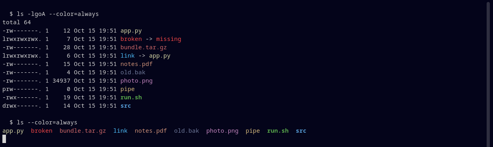

# Deepwick for dircolors

Deepwick colors for `ls` and other tools that read `LS_COLORS`, as a [GNU dircolors](https://www.gnu.org/software/coreutils/dircolors) database.

> Deepwick is an unofficial theme derived from
> [Polywick Blue](https://vscode.polywickstudio.net) by Polywick Studio (MIT).
> Not affiliated with Polywick Studio.



## Install

```sh
cp deepwick.dircolors ~/.dircolors
```

Debian and Ubuntu's stock `~/.bashrc` loads `~/.dircolors`, and so does
Fedora's `/etc/profile.d/colorls.sh` (as long as there is no `~/.dir_colors`,
which it reads first). Otherwise, add to `~/.bashrc` or `~/.zshrc`:

```sh
eval "$(dircolors -b ~/.dircolors)"
```

For fish, add to `~/.config/fish/config.fish`:

```fish
eval (dircolors -c ~/.dircolors)
```

## Notes

- Uses 24-bit colors; your terminal must support truecolor.
- Directories Blue bold, executables Green bold, symlinks Cyan, broken links
  Red, sockets/FIFOs/devices Gold, archives Rose, images/audio/video Magenta,
  documents Orange, source and build files Yellow, temporary, backup and
  compiled files Muted.
- Set-user-ID, set-group-ID and world-writable entries keep the stock warning
  style (Background text on Red, Yellow, Green or Teal).
- Tools that read `LS_COLORS` (eza, fd, tree, zsh completion) pick these up too.

Tested with GNU coreutils 9.10.

## License

MIT. See [LICENSE](LICENSE).
